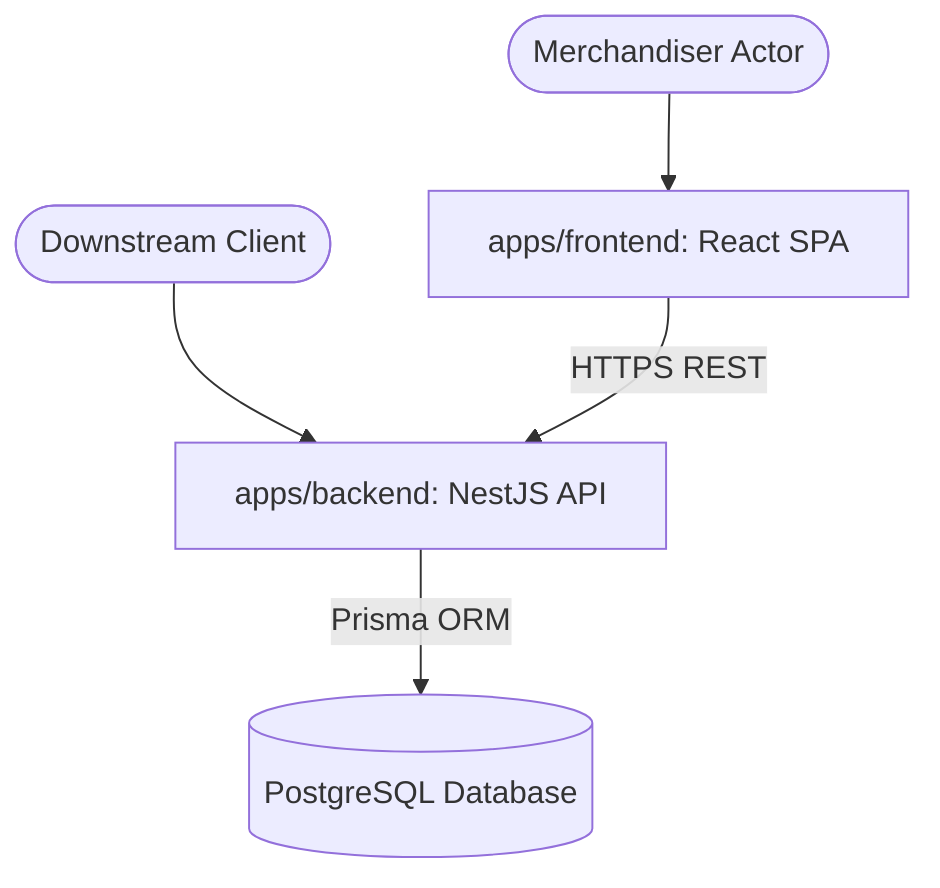
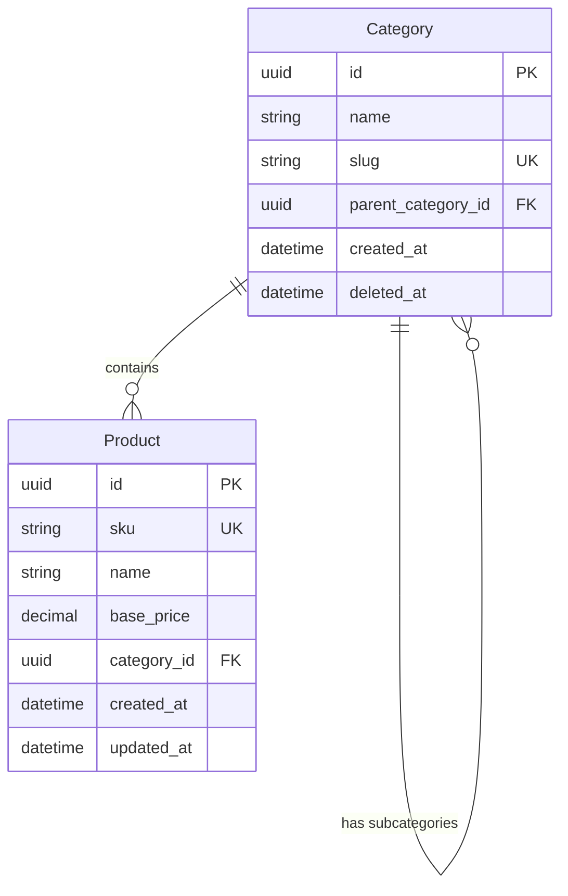
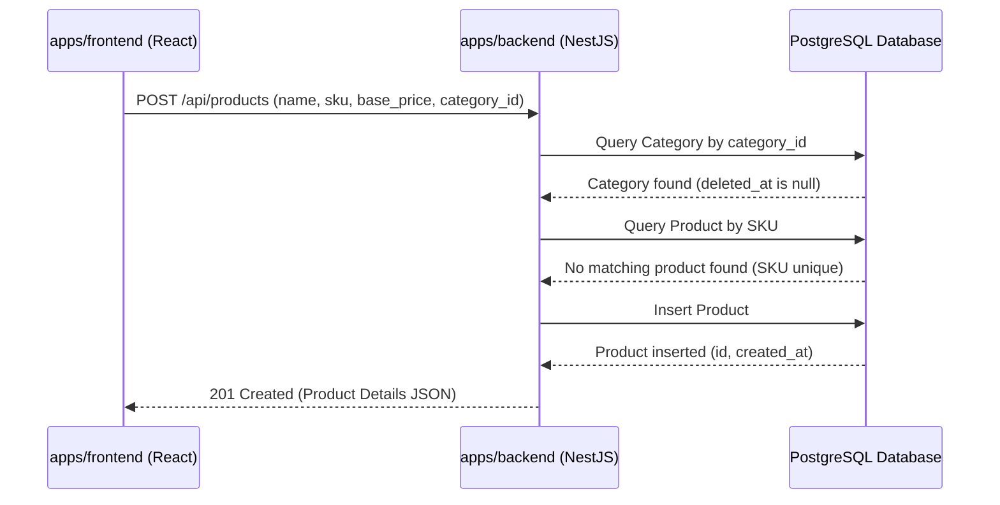

# Technical Architecture - Product Catalog Service

**Product Version:** 1.0
**Status:** approved

## 1. System Context & Execution Boundaries

The Product Catalog Service is an execution ecosystem (Pattern B Monorepo) comprising a NestJS backend REST service and a React merchandiser frontend, persisting to PostgreSQL.

| Execution Boundary | Boundary Type | Deployable | Primary Responsibility |
| :--- | :--- | :--- | :--- |
| `product-catalog-backend` | service | true | REST APIs, DTO validation, and Prisma database persistence |
| `product-catalog-frontend` | application | true | React merchandiser UI and catalog administration dashboards |

## 2. Component Diagram

## 3. Entity Relationship Diagram (ERD)

The database schema consists of a self-referencing `Category` table and a `Product` table connected by a one-to-many relationship:

## 4. Integration Sequence Diagrams

Traces the flow for creating a new product, enforcing category checks and SKU uniqueness constraints:

## 5. Technical Constraints & Design Choices
* **Persistence Strategy:** PostgreSQL 16 managed via Prisma ORM schema migrations.
* **Soft-Deletion:** Managed through indexed nullable `deleted_at` timestamps on `Category`.
