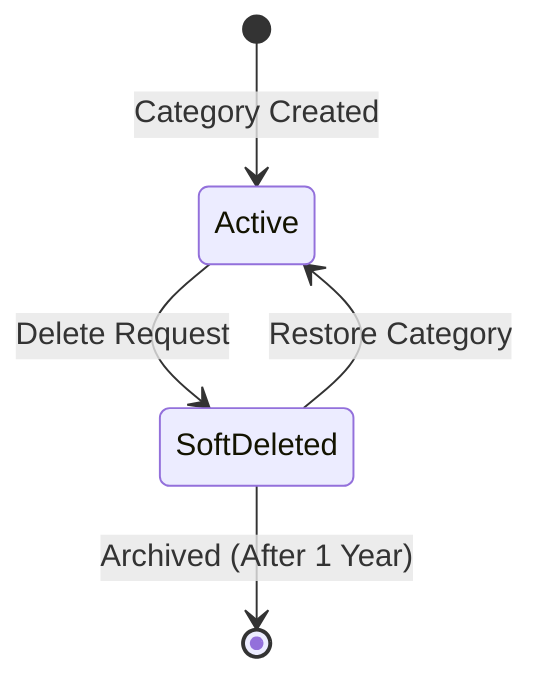

# Functional Requirements Document (FRD) - Product Catalog Monolith

**Document ID:** FRD-001
**Scoped Scope:** Product 1.0 (Collapsed MVP Mode)
**Product Version:** 1.0
**Status:** approved

---

## 1. Overview & Scoped Features

This document specifies the exact functional behavior, domain validation logic, state transitions, and error contracts for the following features scoped directly from the Feature Catalogue for **Product Version 1.0**:
* **F-001 v1:** Category Hierarchy Management
* **F-002 v1:** Product Master Management

Under **Collapsed MVP Mode**, the project does not maintain an intermediate `04_MVP.md` artifact. The entire product is delivered as a unified release increment.

---

## 2. Functional Requirements

### Feature: F-001 Category Hierarchy Management (v1)

#### FR-001-01: Recursive Hierarchical Categorization
* **Description:** The system must allow users to organize categories in parent-child hierarchies up to 3 levels deep (Root -> Subcategory -> Sub-subcategory).
* **Trigger:** User creates or updates a category with an optional `parent_category_id`.
* **Input Parameters:**
  | Field | Type | Required | Validation Rules |
  | :--- | :--- | :--- | :--- |
  | `name` | string | Yes | 2 to 100 characters |
  | `parent_category_id` | UUID | No | Must reference an existing active category with depth < 3 |
* **System Processing & Business Logic:**
  1. If `parent_category_id` is supplied, calculate current ancestor depth.
  2. If depth >= 3, reject request.
  3. Ensure no cyclical parent-child relationships exist.
* **Output / Response:** Standard Category object with `id`, `name`, `slug`, `parent_category_id`, and `created_at`.
* **Error & Exception Handling:**
  - Return `CATEGORY_DEPTH_EXCEEDED` (HTTP 422) if depth exceeds 3 levels.
  - Return `CIRCULAR_DEPENDENCY` (HTTP 422) if parent links to a descendant.

#### FR-001-02: Slug Auto-Generation & Sanitization
* **Description:** Slugs must be automatically generated from category names if not provided, sanitized (lowercase, alphanumeric with hyphens), and globally unique.
* **Validation Rules:** Pattern `^[a-z0-9]+(-[a-z0-9]+)*$`.
* **Conflict Resolution:** If a slug collision occurs, append an incremental numeric suffix (e.g., `electronics-2`).

#### FR-001-03: Category Soft-Deletion Governance
* **Description:** Deleting a category must set `deleted_at` timestamp rather than executing physical removal, preserving historical order and reporting links while immediately disabling new product assignments.

---

### Feature: F-002 Product Master Management (v1)

#### FR-002-01: Product SKU Validation & Formatting
* **Description:** The system must enforce unique, uppercase alphanumeric SKUs across all active and archived catalog items.
* **Validation Pattern:** `^[A-Z0-9-]{3,20}$`.
* **Error Handling:** Return `SKU_ALREADY_EXISTS` (HTTP 409) if duplicate SKU is detected.

#### FR-002-02: Pricing Constraints
* **Description:** The system must validate that the product base price is a positive decimal strictly greater than `0.00`.
* **Error Handling:** Return `INVALID_PRICE` (HTTP 422) if `price <= 0`.

#### FR-002-03: Active Category Assignment Assertion
* **Description:** When onboarding or updating a product, the specified `category_id` must resolve to an active, non-soft-deleted category record.
* **Error Handling:** Return `CATEGORY_INACTIVE_OR_NOT_FOUND` (HTTP 422) if category does not exist or has non-null `deleted_at`.

---

## 3. System State Transitions

---

## 4. Local Technical Decisions
* **LTD-01:** In this monolith deployment, category depth validation and SKU formatting are verified via monolithic NestJS service validators within the same memory process before database commit.
