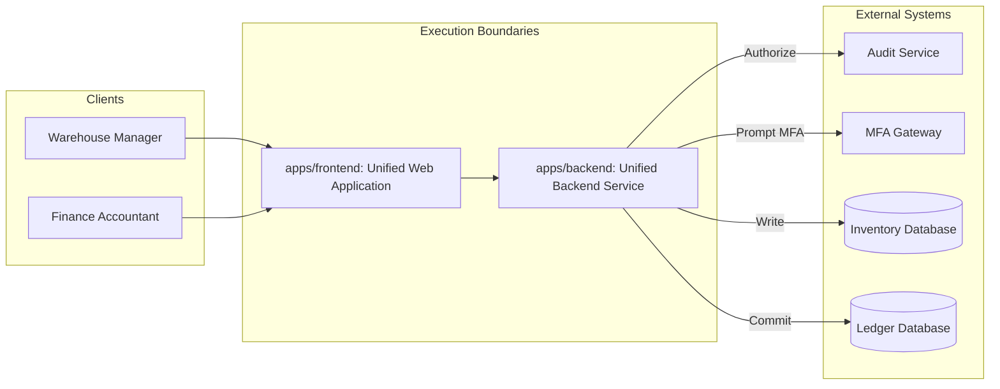
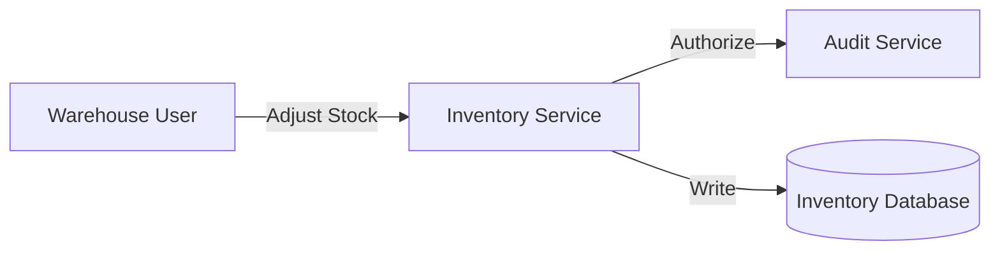
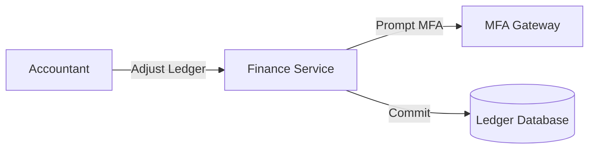

# Technical Architecture - Enterprise Workspace

**Workspace:** `WS-ENTERPRISE`
**Status:** approved

---

## 1. System Topology & Execution Boundaries
The enterprise workspace coordinates shared backend and frontend execution boundaries supporting multiple independent business domain specifications (`PROD-INVENTORY` and `PROD-FINANCE`).

## 2. Domain Boundary Integrations

### 2.1 Inventory Domain Integrations
The inventory domain interfaces with warehouse devices and logs access control events to the audit service.

### 2.2 Finance Domain Integrations
The finance domain interfaces with the multi-factor authentication gateway to authorize ledger updates.

