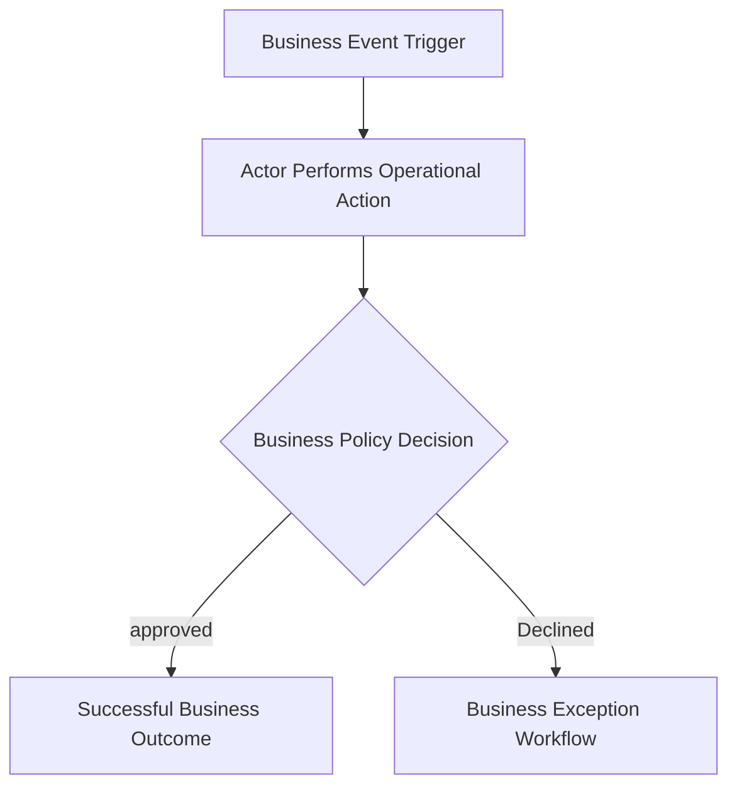
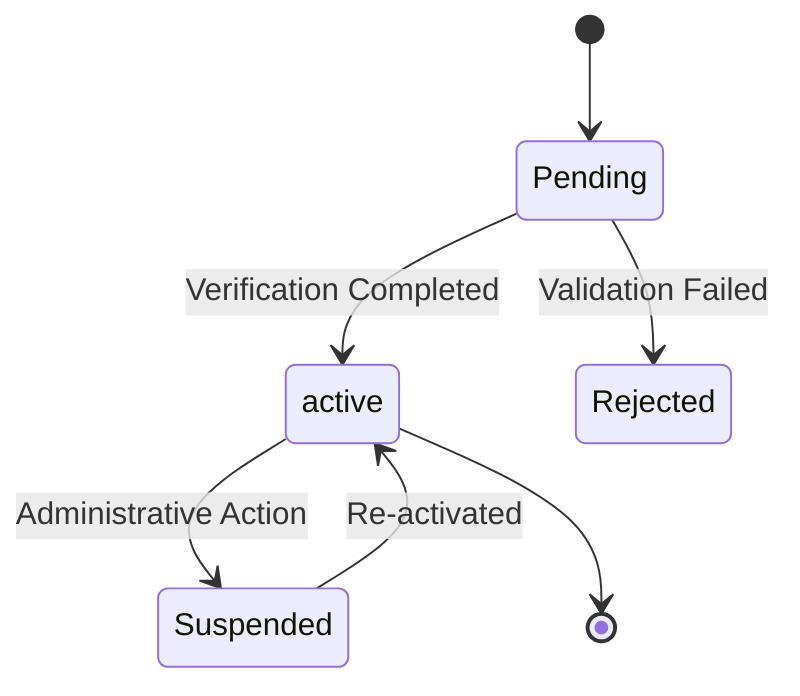
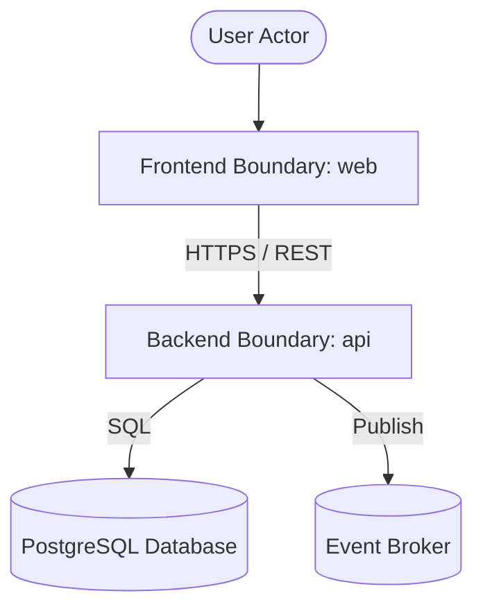
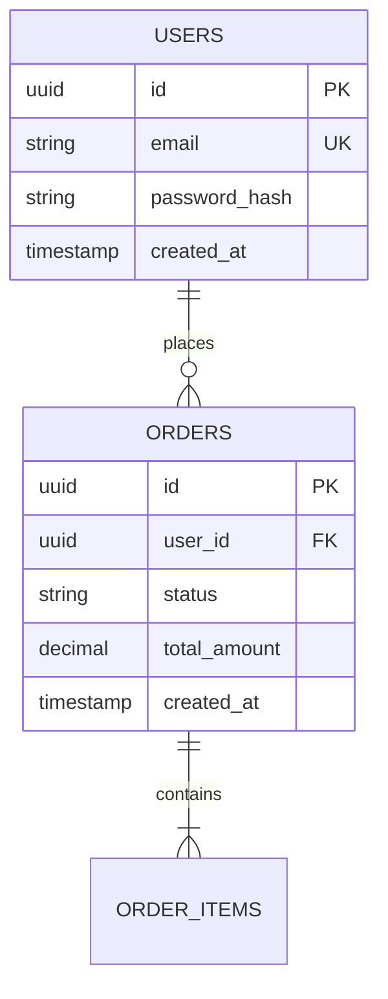
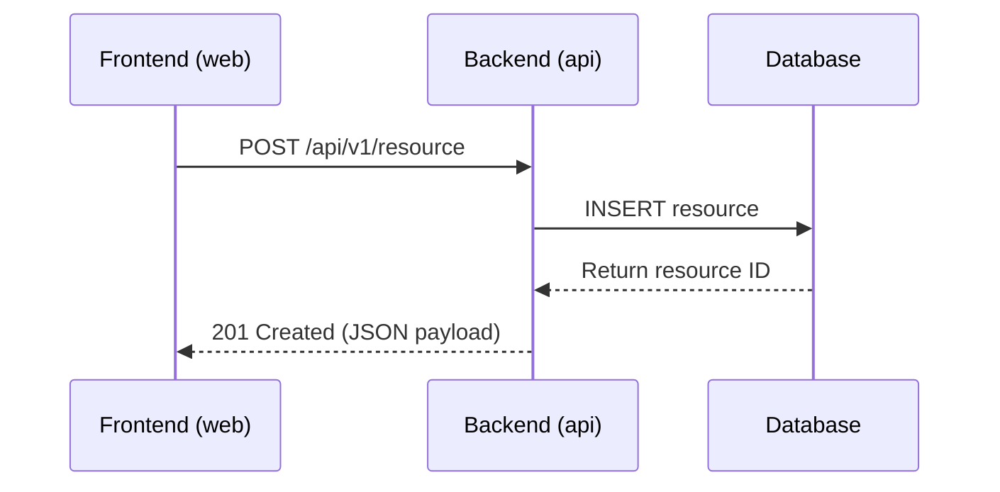

# Blueprint: Product-Centric Specs & Execution Boundary Documentation Approach
**Version:** 5 (draft)
**Author:** [@mfauzanfikri](https://github.com/mfauzanfikri)

This document defines the standard requirements, structures, templates, and workflows for product-centric documentation with explicit execution boundary ownership under the Version 5 specification. Replicate this blueprint for future projects that need clear specification boundaries, traceable implementation ownership, and lightweight, machine-validated governance.

---

# 1. Objectives

The blueprint must:

* Establish the **Feature Catalogue** as the product-wide inventory and authority for feature identity, history, and versioning.
* Enforce **Semantic Feature Versioning (`MAJOR.MINOR`)** where the Major version serves as the stable traceability anchor.
* Support **bounded incremental delivery via optional MVP artifacts**, while natively supporting **collapsed no-MVP mode** for simple projects without artificial documentation overhead.
* Establish the **Functional Requirements Document (FRD)** as a dedicated functional specification layer distinct from technical design.
* Transition from manual mapping documents to **machine-validated structural traceability**, eliminating `REQUIREMENT_MAPPING.md` while preserving complete requirement-to-evidence integrity.
* Partition technical concerns cleanly into **Architecture** (system design) and **Technical Standards** (authoritative engineering rules).
* Establish **`METADATA.md`** as a declarative, machine-validated documentation map and version registry.
* Optimize for **AI-assisted development** through deterministic initialization sequences and explicit authority boundaries.
* Preserve local implementation ownership inside execution boundaries (`README.md`, `ROADMAP.md`, `CHANGELOG.md`).
* Support independent evolution of deployable boundaries without forcing version locks with Product Versions.
* Support multi-repo, monorepo, monolith, package, and infrastructure topologies without prescribing repository structure.
* Support brownfield adoption and seamless semantic migration from Blueprint Version 4.
* Remain lightweight, practical, and devoid of speculative bureaucracy.

The framework standardizes concepts, responsibilities, relationships, and constraints. It does not standardize repository names, folder names, architecture styles, frameworks, deployment patterns, CI/CD tooling, infrastructure providers, or package managers.

---

# 2. Core Concepts

| Concept | Responsibility |
| :--- | :--- |
| **Blueprint Version** | Documentation framework evolution (e.g., `Blueprint Version: 5`). |
| **Product Version** | Business and product capability evolution (e.g., `Product Version: 2.0`). |
| **Feature (`F-XXX`)** | Canonical feature identity and lifecycle within the product universe. |
| **Feature Version (`vX.Y`)** | Feature evolution. `MAJOR` = functional contract evolution; `MINOR` = backward-compatible refinements. |
| **Minimum Viable Product (MVP)** | Optional bounded delivery increment selecting specific Feature Major Versions. |
| **Functional Requirements Document (FRD)** | Detailed functional specification of features scoped within an MVP or product. |
| **Specification Boundary** | Business ownership, product intent, feature registry, and functional specifications. |
| **Execution Boundary** | Implementation ownership, local task tracking, and deployable revision evidence. |
| **Boundary Version** | Deployable revision lifecycle inside an execution boundary (e.g., `v3.1.0`). |
| **Technical Documentation** | Domain container for system architecture and engineering standards. |
| **Documentation Map (`METADATA.md`)** | Machine-validated registry of documentation paths, versions, and topologies. |

Canonical governance rules:
* The retired artifact is canonically named `REQUIREMENT_MAPPING.md`; it is never an active V5 artifact.
* Repeated increments use repository-relative paths `docs/mvp/MVP-XXX.md` and `docs/frd/FRD-XXX.md`. All `METADATA.md` paths are repository-relative.
* Machine statuses are lowercase: `draft`, `planned`, `in_progress`, `approved`, `active`, `released`, `superseded`, `deprecated`, `retired`, and `archived`.
* Artifacts are classified as always-required, applicable-only, temporary, or generated. Generated views are derived, non-authoritative, and must never become manually maintained mapping tables.
* A domain folder is not automatically a Product: one Product has one PRD; independently governed Products each have their own Product ID and PRD.

Conceptual relationships:

```text
                              PRODUCT
                                 │
        ┌────────────────────────┼────────────────────────┐
        │                        │                        │
       BRD                      PRD              Feature Catalogue
        │                        │                        │
        └────────────────────────┴────────────────────────┘
                                 │
                                 ▼
                         MVP (optional)
                                 │
                                 ▼
                               FRD
                                 │
                                 ▼
                           User Stories
                                 │
                                 ▼
                             Execution
                        (ROADMAP / CHANGELOG)


        TECHNICAL FOUNDATION
                 │
                 ├── Architecture
                 └── Technical Standards


        DECISION GOVERNANCE
                 │
                 └── Decision Log


        PROJECT DOCUMENTATION MAP
                 │
                 └── METADATA.md
```

Relationship rules:
* A Product Version may contain zero or more MVPs; each MVP belongs to exactly one Product Version and has exactly one FRD. A Feature Major Version may be selected by multiple MVPs. Enabled mode requires at least one MVP; collapsed mode uses exactly one product-scoped FRD. Released MVP scopes and FRDs are immutable; changes create a new version or superseding document.
* A **Product Version** groups the delivery of features and functional milestones.
* The **Feature Catalogue** registers all features (`F-001`, `F-002`) across the entire product lifecycle.
* An **MVP** (when used) selects specific Feature Major Versions (`F-001 v2`, `F-003 v1`) for a bounded release.
* When MVP is not used (simple project), the model **collapses natively**: the FRD directly scopes features from the Feature Catalogue for the Product Version.
* Exactly **one FRD** exists per MVP (or one per Product Version in collapsed mode).
* **User Stories** are decomposed from FRD functional requirements.
* An **Execution Boundary** implements user stories across one or more specification boundaries and records verification criteria in local `ROADMAP.md` and release evidence in `CHANGELOG.md`.
* `METADATA.md` registers all documentation paths, active versions, component versions, and MVP feature selections.

---

# 3. Documentation Philosophy & Authority Hierarchy

V5 strictly enforces an **Explicit Authority Model** to eliminate overlapping or conflicting sources of truth.

```text
BRD
Business Authority ("Why")
      ↓
PRD
Product Authority ("What product capabilities")
      ↓
Feature Catalogue
Feature Registry & Identity Authority ("What features exist")
      ↓
MVP (Optional)
Scope Selection Authority ("Which feature versions are bundled together")
      ↓
FRD
Functional Behavior Authority ("How features behave functionally")
      ↓
User Stories
Implementation Slicing Authority ("How functional requirements are sliced for execution")
      ↓
Execution (ROADMAP / CHANGELOG)
Implementation State & Evidence Authority ("How and where code implements requirements")
```

Parallel technical authorities govern technical concerns:

```text
Architecture
Technical Design Authority ("What technical system is being built")

Technical Standards
Technical Rule Authority ("What engineering rules must implementation follow")

Decision Log
Decision & Rationale Authority ("Why technical or product choices were made")

METADATA.md
Documentation Map & Version Registry Authority ("Where documents live and what is current")
```

### Authority Boundaries & Non-Duplication Rules

1. **`BRD` owns business justification.** It defines business goals, stakeholders, business processes, and success metrics. It does not define UI layouts, system endpoints, database fields, or technical architecture.
2. **`PRD` owns product scope and high-level capabilities.** There is strictly **one PRD per Product**. It does not duplicate BRD business flows, nor does it contain detailed functional edge-case specifications (which belong in FRD).
3. **`Feature Catalogue` owns feature identity.** It defines canonical Feature IDs (`F-XXX`), high-level feature summaries, major/minor version history, and lifecycle status. It does not contain execution checklists or technical designs.
4. **`MVP` owns scope selection.** It binds a set of Feature Major Versions into an increment. It does not specify functional logic.
5. **`FRD` owns detailed functional behavior.** It defines detailed functional requirements (`FR-XXX-YY`), input/output rules, state transitions, validation logic, and error handling for the features in scope. It does not specify technical database schemas, ORM models, or infrastructure.
6. **`User Stories` owns implementation slicing.** It breaks FRD functional requirements into developer-implementable user stories with acceptance criteria.
7. **`Architecture` owns technical design.** It defines service topologies, data flow sequence diagrams, database ERDs, technical persistence metadata, and boundary constraints. It does not introduce business requirements.
8. **`Technical Standards` owns engineering policies.** It defines cross-boundary coding rules, API standards, messaging schemas, idempotency rules, and security baselines.
9. **`Decision Log` owns decision rationale.** It records context, evaluated alternatives, trade-offs, and final decisions (ADRs).
10. **`METADATA.md` owns documentation registration.** It maps paths, versions, and relationships. It is non-authoritative for requirement or technical content.
11. **Execution Boundaries own implementation.** Local `README.md`, `ROADMAP.md`, and `CHANGELOG.md` track task execution and evidence. They must never duplicate or rewrite specifications as independent truth.

---

# 4. Documentation Blueprint Versioning

The Documentation Blueprint framework maintains its own version independent from Product Versions and Boundary Versions.

## Format

Major versions only:
```text
1
2
3
4
5
```

## Rules

* Major versions represent fundamental paradigm shifts, architectural evolutions, or structural contract updates.
* Central revisions under proposal are drafted in `plan.v<major>.blueprint.md` at repository root with a draft entry in `CHANGELOG.md`.
* When finalized and approved, the previous major version is frozen in `archive/v<previous_major>/` along with its reference examples, and the new specification becomes `00_Documentation_Blueprint.md`.

## Version History Summary

### Blueprint Version 1
Initial release of decoupled specifications and distributed roadmaps framework with basic BRD, User Stories, Diagrams, Requirement Mapping, and distributed execution roadmaps.

### Blueprint Version 2
Introduced Product Requirements Document (PRD), Decision Log (ADRs), Architecture replacing Diagrams, and separate execution-boundary CHANGELOGs for historical tracking.

### Blueprint Version 3
Introduced temporary Project Context, evidence and confidence classification, formal artifact contracts, traceability integrity validation, master-service hierarchy, and temporal scope governance.

### Blueprint Version 4
Introduced Product-Centric terminology, Execution Boundary models, independent Boundary Versioning, compatibility metadata governance, Documentation Initialization, domain-distributed specification structures, and deterministic validation assertions.

### Blueprint Version 5 (Current)
Introduced the product-wide Feature Catalogue, Semantic Feature Versioning (`MAJOR.MINOR`), optional MVP scoping and native collapsed no-MVP mode, Functional Requirements Document (FRD), machine-validated structural traceability (retiring manual Requirement Mapping tables), clear technical documentation partitioning (Architecture vs. Technical Standards), and declarative `METADATA.md` documentation mapping.

---

# 5. Documentation Initialization

Before generating documentation for any project, the analyst and lead engineer must initialize the documentation topology and configuration.

### Initialization Steps

1. **Topology Selection:** Determine the repository layout pattern:
   - Pattern A: Multi-Repository Layout
   - Pattern B: Single-Repository Monorepo Layout
   - Pattern B Variant: Domain-Distributed Workspace Layout
   - Pattern C: Single-Repository Monolith Layout
2. **Delivery Increment Strategy (MVP Mode):**
   - **`enabled` (Multi-Increment):** Used when the product is delivered via bounded iterative increments (MVP-001, MVP-002, etc.). Requires `docs/mvp/MVP-001.md` and increment-specific FRDs (`FRD-001.md`, `FRD-002.md`).
   - **`collapsed` (No-MVP / Single-Increment):** Used for simple projects or single-release systems. Bypasses `docs/mvp/MVP-001.md`; the FRD directly scopes features from the Feature Catalogue for the Product Version.
3. **Execution Boundary Identification:** Identify all workspaces, applications, services, packages, or infrastructure units, their deployability, and ownership.
4. **draft `METADATA.md`:** Author the project-level `METADATA.md` registering the product, topology, initial document paths, versions, and execution boundaries.
5. **Baseline Context Capture:** If adopting an existing codebase (brownfield), author a temporary `PROJECT_CONTEXT.md` recording observed facts, evidence classifications, and unknowns.

---

# 6. Project Context

Project Context is a **temporary, non-authoritative adoption artifact** used when bootstrapping or reverse-engineering existing codebases.

## 6.1 Purpose
* Captures observed runtime behaviors, existing code structures, database schemas, and configuration facts.
* Distinguishes confirmed implementation facts from assumptions and unknowns.
* Provides AI agents and analysts with reliable baseline context without polluting authoritative specifications.

## 6.2 Lifecycle & Disposal
* Project Context is created during initialization or brownfield discovery.
* Once authoritative V5 artifacts (`01_BRD.md`, `02_PRD.md`, `03_Feature_Catalogue.md`, `07_Architecture.md`, etc.) are synthesized, approved, and validated, `PROJECT_CONTEXT.md` is deprecated or archived.
* Authoritative specifications must never link to `PROJECT_CONTEXT.md` as ongoing source of truth.

---

# 7. Evidence and Confidence Classification

When documenting brownfield discoveries, validation findings, or technical verification evidence, statements must be tagged with explicit evidence classifications and confidence levels.

## 7.1 Classifications

* **Explicit Fact:** Confirmed directly from authoritative source code, running production configurations, verified test suites, or signed business contracts.
* **Derived Fact:** Inferred logically from combining multiple explicit facts (e.g., inferring business rules from database schema constraints and API validation logic).
* **Assumption:** Unverified belief regarding system behavior, user expectation, or operational intent. Must be flagged for validation.
* **Unknown:** Explicitly identified gap in knowledge where documentation or code inspection failed to determine the answer.

## 7.2 Confidence Levels

* **High:** Supported by direct code inspection, passing automated tests, or authoritative stakeholder sign-off.
* **Medium:** Supported by secondary documentation, partial code evidence, or unverified configurations.
* **Low:** Based on anecdotal recollection, unverified comments, or speculative interpretation.

## 7.3 Evidence Promotion
Assumptions and Derived Facts must be validated and promoted to Explicit Facts before finalizing Major Product Version release blocks.

---

# 8. Documentation Topology

## 8.1 Specification Boundary Namespace Rules
In distributed specification environments (such as Domain-Distributed monorepos or multi-repo suites), requirement identifiers must maintain domain prefixes to prevent collision:
```text
[DOMAIN]-[ENTITY]-[IDENTIFIER]
Example: AUTH-F-001, BILLING-FR-001-01, INVENTORY-US-005
```

## 8.2 Execution Boundary Model
An Execution Boundary is an implementation ownership unit:
* **Application:** User-facing frontend, mobile app, CLI tool.
* **Service:** Backend API, microservice, background worker.
* **Monolith:** Unified deployable containing multiple functional concerns.
* **Package / Library:** Shared SDK, utility library, component library.
* **Infrastructure:** Terraform workspace, Kubernetes manifests, CI/CD pipeline.

## 8.3 Deployability & Boundary Roles
* **Deployable (`deployable: true`):** Can be built, containerized, and deployed independently. Owns an independent **Boundary Version**, declares `compatible_product_versions`, and maintains an execution `CHANGELOG.md`.
* **Non-Deployable (`deployable: false`):** Internal packages, shared configs, documentation boundaries. Does not require independent SemVer releases.
* **Boundary Roles in Traceability:**
  - `requirement_owner`: The primary execution boundary responsible for satisfying the user story. Exactly one execution boundary is the `requirement_owner` for a user story. Multiple criteria inside that owning boundary may carry `requirement_owner`, but no other execution boundary may claim `requirement_owner` for the same story.
  - `supporting_boundary`: A boundary providing auxiliary services (e.g., frontend calling a backend API, infrastructure provisioning database).
  - `evidence_source`: A boundary providing test or verification evidence.

## 8.4 Single Blueprint Authority
Except for this central distributor repository, an adopted repository workspace must contain **exactly one copy** of the master blueprint (`00_Documentation_Blueprint.md`) at root or in `docs/`. Domain folders or sub-boundaries must never duplicate the master blueprint.

## 8.5 Domain Identity Preservation
When domains or features are refactored, canonical IDs must remain stable. If a feature ID must be replaced, the Feature Catalogue must preserve historical lineage using `supersedes` or `legacy_ids` metadata.

---

# 9. Repository & Workspace Structures

## Pattern A: Multi-Repository Layout

Specifications and each execution boundary live in separate Git repositories.

```text
product-specs/ (Repository 1)
├── METADATA.md                    # Project documentation map & version registry
├── 00_Documentation_Blueprint.md
├── 01_BRD.md
├── 02_PRD.md
├── 03_Feature_Catalogue.md        # Product-wide feature registry & versions
├── mvp/
│   └── MVP-001.md                 # active MVP increment scope (optional)
├── frd/
│   └── FRD-001.md                 # active functional requirements
├── 06_User_Stories.md             # Sliced user stories
├── 07_Architecture.md             # Technical system design & ERDs
├── 08_Technical_Standards.md      # Engineering rules & API conventions
├── 09_Decision_Log.md             # ADRs
├── CHANGELOG.md                   # Product capability release history
├── references/                    # Non-authoritative reference materials
└── README.md

product-backend/ (Repository 2)
├── README.md                      # Boundary metadata, setup, and compatibility
├── ROADMAP.md                     # Technical verification criteria & pending tasks
├── CHANGELOG.md                   # Boundary release history & verification evidence
└── src/

product-frontend/ (Repository 3)
├── README.md
├── ROADMAP.md
├── CHANGELOG.md
└── src/
```

## Pattern B: Single-Repository Monorepo Layout

A single repository containing centralized `/docs/` and multiple execution boundaries.

```text
product-monorepo/
├── METADATA.md                    # Project documentation map & version registry
├── docs/
│   ├── 00_Documentation_Blueprint.md
│   ├── 01_BRD.md
│   ├── 02_PRD.md
│   ├── 03_Feature_Catalogue.md
│   ├── mvp/
│   │   └── MVP-001.md             # Optional increment scope
│   ├── frd/
│   │   └── FRD-001.md
│   ├── 06_User_Stories.md
│   ├── 07_Architecture.md
│   ├── 08_Technical_Standards.md
│   ├── 09_Decision_Log.md
│   ├── CHANGELOG.md
│   └── references/
├── apps/
│   ├── api/
│   │   ├── README.md              # Backend boundary metadata & compatibility
│   │   ├── ROADMAP.md             # Backend verification criteria
│   │   └── CHANGELOG.md           # Backend release evidence
│   └── web/
│       ├── README.md              # Frontend boundary metadata & compatibility
│       ├── ROADMAP.md             # Frontend verification criteria
│       └── CHANGELOG.md           # Frontend release evidence
└── packages/
    └── ui-lib/
        ├── README.md              # Non-deployable package metadata
        └── ROADMAP.md
```

### Pattern B Variant: Domain-Distributed Workspace

Large enterprise workspaces where separate business domains own their functional specifications, while sharing workspace-level technical foundations.

```text
enterprise-workspace/
├── METADATA.md                    # Aggregated documentation map
├── docs/
│   ├── 00_Documentation_Blueprint.md  # Single Blueprint Authority
│   ├── 07_Architecture.md             # System-wide architecture
│   ├── 08_Technical_Standards.md      # Shared engineering standards
│   ├── 09_Decision_Log.md             # Global ADRs
│   └── references/
├── domains/
│   ├── identity/
│   │   ├── 01_BRD.md
│   │   ├── 02_PRD.md
│   │   ├── 03_Feature_Catalogue.md
│   │   ├── mvp/
│   │   │   └── MVP-001.md
│   │   ├── frd/
│   │   │   └── FRD-001.md
│   │   ├── 06_User_Stories.md
│   │   └── CHANGELOG.md
│   └── billing/
│       ├── 01_BRD.md
│       ├── 02_PRD.md
│       ├── 03_Feature_Catalogue.md
│       ├── frd/
│       │   └── FRD-001.md         # Collapsed no-MVP mode
│       ├── 06_User_Stories.md
│       └── CHANGELOG.md
└── apps/
    ├── auth-service/
    └── billing-service/
```

## Pattern C: Single-Repository Monolith Layout (Collapsed MVP Demonstration)

A single deployable application where incremental MVP planning is not required.

```text
monolith-product/
├── METADATA.md                    # Declares mvp_mode: collapsed
├── docs/
│   ├── 00_Documentation_Blueprint.md
│   ├── 01_BRD.md
│   ├── 02_PRD.md
│   ├── 03_Feature_Catalogue.md    # Product feature inventory
│   ├── frd/
│   │   └── FRD-001.md             # Scopes features directly for Product Version
│   ├── 06_User_Stories.md
│   ├── 07_Architecture.md
│   ├── 08_Technical_Standards.md
│   ├── 09_Decision_Log.md
│   └── CHANGELOG.md
├── README.md                      # Deployable Monolith README
├── ROADMAP.md                     # Monolith technical verification criteria
├── CHANGELOG.md                   # Monolith boundary release history
└── src/
```

---

# 10. Artifact Contracts

Every artifact contract defines its mandatory structural properties:
```yaml
purpose: Primary mission of the artifact
primary_question: The core question it answers
allowed_content: Explicitly permitted topics and data
forbidden_content: Strictly prohibited content
dependencies: Upstream inputs required
temporal_scope: State-sensitivity and lifecycle duration
authority_level: Specific domain where this artifact is the supreme source of truth
```

## 10.0 Common Document Identity Contract
Every applicable artifact begins with this metadata block; `document_version` is distinct from product, feature, MVP, and boundary versions. `BO-XXX` and `PC-XXX` are stable upstream identifiers; business processes, constraints, and success criteria may likewise use stable IDs when referenced.

```yaml
---
document_id: DOC-XXX
document_type: brd
document_version: "1.0"
blueprint_version: 5
product_id: PROD-NAME
product_version: "1.0"
status: draft
scope:
  kind: product
  id: PROD-NAME
authority: business
owner: [team-or-role]
last_updated: YYYY-MM-DD
---
```
Each artifact template specifies its `document_type`, `scope.kind`, `scope.id`, and `authority`. Artifacts with `scope.kind: workspace` govern shared technical foundations across multiple products (e.g. Pattern B Variant workspace architecture or shared standards); they declare `scope.id: [workspace-id]` and list applicable `product_ids` (or set `product_id: MULTI-PRODUCT`).

## 10.1 `METADATA.md` Contract
```yaml
purpose: Declarative registry of project documentation, active versions, paths, topologies, and boundary compatibility.
primary_question: What documentation exists, where is it, what version is current, and how does it relate?
allowed_content:
  - Blueprint version declaration
  - Product identity and current Product Version
  - Documentation topology and MVP mode declaration
  - File path registry for all specification and technical artifacts
  - active MVP increment and Feature Major Version bindings
  - Execution boundary registry with versions, paths, and compatibility declarations
forbidden_content:
  - Business requirements or user story text
  - Functional logic or state machine specifications
  - Technical architecture diagrams or API endpoint definitions
  - Manual requirement mapping tables
dependencies: None (Root discovery entrypoint)
temporal_scope: active product documentation state.
authority_level: Project Documentation Registry & Topology Authority.
```

## 10.2 BRD Contract
```yaml
purpose: Define business intent, stakeholders, operational scope, and business success criteria.
primary_question: Why does the business need this?
allowed_content:
  - Business objectives and problem statements
  - Stakeholder groups and operational roles
  - In-scope and out-of-scope business boundaries
  - Core business entities and business-significant attributes
  - High-level business flow diagrams (actor/process-level)
  - Business constraints, policies, and measurable success criteria
forbidden_content:
  - Detailed UI/UX screen interactions or widget behaviors
  - Technical architecture, database schemas, foreign keys, or ORM fields
  - API routes, network protocols, or payload definitions
  - Implementation tasks, sprint plans, or release checklists
dependencies: Project Context (optional brownfield input)
temporal_scope: Stable business intent for the active Product Version.
authority_level: Business Source of Truth.
```

## 10.3 PRD Contract
```yaml
purpose: Define product vision, personas, global capabilities, and user journeys for the product.
primary_question: What product are we defining and what should it accomplish?
allowed_content:
  - Product vision and value proposition
  - Target personas and user profiles
  - Product capabilities and high-level capability scope
  - User journeys and macro product interaction flows
  - Verified Figma, wireframe, or prototype references
  - References to BRD business goals
forbidden_content:
  - Duplication of BRD business process ownership
  - Detailed functional field validation rules and edge-case specs (belongs in FRD)
  - Fabricated or placeholder Figma/design URLs
  - Technical database schemas, API implementations, or code frameworks
  - Execution task tracking
dependencies: BRD
temporal_scope: approved product scope for the active Product Version. Exactly one PRD per Product.
authority_level: Product Definition Source of Truth.
```

## 10.4 Feature Catalogue Contract
```yaml
purpose: Provide the product-wide inventory, identity registry, history, and version governance for all features.
primary_question: What features make up the product universe?
allowed_content:
  - Stable Canonical Feature IDs (F-XXX)
  - Feature names and high-level functional summaries
  - Feature lifecycle state (proposed, active, deprecated, retired)
  - Feature version history table tracking MAJOR.MINOR versions
  - Summary of changes, change types (Major/Minor), and active MVP/Product Version bindings
  - High-level feature-to-feature dependencies
forbidden_content:
  - Detailed system state machines or validation logic (belongs in FRD)
  - User story slicing or acceptance criteria (belongs in User Stories)
  - Implementation code, database schemas, or API routes
  - Live task tracking checklists
dependencies: PRD
temporal_scope: Enduring product-wide feature inventory across all Product Versions.
authority_level: Feature Identity and Version Registry Source of Truth.
```

## 10.5 MVP Contract (Optional)
```yaml
purpose: Define the scope boundary and delivery goal for a specific bounded implementation increment.
primary_question: Which features are being delivered together in this increment?
allowed_content:
  - MVP Identifier (MVP-XXX)
  - Increment name and target delivery goal
  - Target Product Version
  - Explicit list of selected Feature Major Versions (e.g., F-001 v2, F-003 v1)
  - Target release date and deployment milestone assumptions
  - Reference to corresponding FRD (FRD-XXX)
forbidden_content:
  - Detailed functional behavior or edge-case specifications (belongs in FRD)
  - Technical system architecture or database designs
  - Execution roadmaps or task checklists
dependencies: Feature Catalogue, PRD
temporal_scope: Lifecycle of the specific delivery increment (planned -> in_progress -> released -> archived).
authority_level: Increment Scope Selection Source of Truth.
```

## 10.6 FRD Contract
```yaml
purpose: Define detailed functional behavior, rules, state flows, and input/output contracts for scoped features.
primary_question: How must the scoped features behave functionally?
allowed_content:
  - Functional Requirement IDs (FR-[FEATURE_NUM]-[REQ_NUM])
  - Scoped Feature Major Version references
  - Detailed user/system interaction flows and state transition diagrams
  - Input fields, data types, validation constraints, and business logic
  - System outputs, notification events, and error/exception behaviors
  - Feature-to-feature functional interactions
  - Local technical decisions specific to this functional milestone
forbidden_content:
  - System architecture topologies, service boundaries, or infrastructure design
  - Physical database schema fields, indexes, or SQL queries (belongs in Architecture)
  - Cross-cutting engineering standards (belongs in Technical Standards)
  - Sprint tasks or execution checklists
dependencies: MVP (or Feature Catalogue in collapsed mode), PRD, BRD
temporal_scope: approved functional specification for the active increment or Product Version.
authority_level: Functional Behavior Source of Truth.
```

## 10.7 User Stories Contract
```yaml
purpose: Translate approved functional requirements into developer-implementable user-centered requirements.
primary_question: How are functional requirements sliced into implementable increments?
allowed_content:
  - Stable User Story IDs (US-XXX or US-[FEATURE_NUM]-[STORY_NUM])
  - Scoped FRD Functional Requirement references (FR-XXX-YY)
  - Scoped Feature Major Version references (F-XXX vY)
  - User role, desired action, and business benefit narrative
  - Testable Acceptance Criteria (Gherkin format or explicit assertion lists)
  - Boundary-specific implementation guidance without prescribing internal code
forbidden_content:
  - Technical task decomposition (belongs in execution ROADMAP)
  - Boundary release evidence or completed code status
  - Duplication of functional validation rules already defined in FRD
dependencies: FRD, PRD
temporal_scope: Implementation requirement intent for the active increment.
authority_level: Implementation Requirement Source of Truth.
```

## 10.8 Architecture Contract
```yaml
purpose: Define system design, service boundaries, integration flows, and technical data architecture.
primary_question: What technical system are we building?
allowed_content:
  - System context and execution boundary topology
  - Component diagrams and communication protocols
  - Entity Relationship Diagrams (ERDs) including database identifiers, foreign keys, relationships, audit timestamps, soft-delete fields, and indexes
  - Integration sequence diagrams and message flows
  - Boundary technical constraints and persistence strategies
forbidden_content:
  - New business requirements or product scope additions
  - Cross-cutting coding conventions, API style rules, or lint policies (belongs in Technical Standards)
  - Execution roadmap checklists or task tracking
  - Boundary release history
dependencies: PRD, FRD, User Stories
temporal_scope: approved technical architecture for the active Product Version.
authority_level: Technical System Design Source of Truth.
```

## 10.9 Technical Standards Contract
```yaml
purpose: Define authoritative, cross-boundary technical rules and conventions that all implementations must follow.
primary_question: What technical rules must implementation follow?
allowed_content:
  - API design standards (REST URI conventions, error payload formats, HTTP status codes)
  - Event and messaging conventions (topic naming, CloudEvents envelope schemas, versioning)
  - Reliability policies (idempotency header semantics, retry policies, dead-letter queues)
  - Security standards (JWT validation, CORS policies, required audit headers)
  - Coding, git commit, and branching conventions
forbidden_content:
  - Product-specific feature requirements or functional logic
  - System topology diagrams or component inventories (belongs in Architecture)
  - Ephemeral task lists
dependencies: Architecture, approved ADRs
temporal_scope: Enduring engineering policies across the product workspace.
authority_level: Technical Rule & Policy Source of Truth.
```

## 10.10 Decision Log Contract
```yaml
purpose: Record significant product, architectural, and engineering decisions along with their context and trade-offs.
primary_question: Why was this decision made?
allowed_content:
  - Decision Identifier (ADR-XXX)
  - Status (draft, proposed, approved, rejected, superseded)
  - Decision date and responsible owner
  - Context and problem statement
  - Alternatives considered and trade-off evaluation
  - Decision outcome and rationale
  - Impact on specifications and execution boundaries
forbidden_content:
  - Minor code refactoring notes
  - Live task tracking
  - Undated or statusless final decisions
dependencies: BRD, PRD, FRD, Architecture
temporal_scope: State-sensitive historical decision record.
authority_level: Decision Rationale Source of Truth.
```

## 10.11 Specs-Level CHANGELOG Contract
```yaml
purpose: Record the chronological release history of product capabilities and business milestones.
primary_question: What business capabilities were released in each Product Version?
allowed_content:
  - Product Version release blocks (MAJOR.MINOR)
  - Included MVP increments and released Feature Major Versions
  - Added, changed, or deprecated product capabilities
  - Unreleased section tracking planned scope
forbidden_content:
  - Code-level bug fixes, dependency bumps, or internal refactors
  - Unverified release claims
dependencies: Feature Catalogue, FRD, Execution CHANGELOGs
temporal_scope: Historical Product Version log.
authority_level: Product Capability Release History Source of Truth.
```

## 10.12 Execution Boundary README Contract
```yaml
purpose: Explain the execution boundary, deployability, local setup, technology stack, and compatibility.
primary_question: What is this execution boundary and what does it own?
allowed_content:
  - Boundary metadata table (Name, Type, Deployable, Boundary Version, Compatible Product Versions, Status, Owner)
  - Boundary purpose and implementation scope
  - Technology stack mapping
  - Setup, build, test, and run quickstart instructions
  - Links to authoritative specifications registered in METADATA.md
forbidden_content:
  - Business requirements rewritten as local truth
  - Product acceptance criteria
  - Roadmap checklists
  - Release history logs
dependencies: METADATA.md, Architecture
temporal_scope: active execution-boundary operating guide.
authority_level: Boundary Implementation Guide Source of Truth.
```

## 10.13 Execution ROADMAP Contract
```yaml
purpose: Track future-oriented, pending technical implementation tasks within an execution boundary.
primary_question: What are we planning to build within this boundary?
allowed_content:
  - Stable Verification Criteria IDs (boundary-scoped)
  - User Story ID references (US-XXX)
  - Boundary role (requirement_owner, supporting_boundary, evidence_source)
  - Product Version
  - MVP ID (optional in collapsed mode)
  - Technical verification task descriptions
  - Status (planned, in_progress)
forbidden_content:
  - Completed historical tasks (must be moved to local CHANGELOG.md upon release)
  - Product specifications rewritten as local truth
  - released changelog entries
dependencies: User Stories, Architecture
temporal_scope: State-sensitive future execution plan.
authority_level: Local Execution Planning Source of Truth.
```

## 10.14 Execution Boundary CHANGELOG Contract
```yaml
purpose: Record technical implementation history and release evidence within an execution boundary.
primary_question: What technical changes have been released in this boundary?
allowed_content:
  - Boundary Version release blocks (SemVer)
  - Declared Compatible Product Versions (and Product IDs if multi-product)
  - Completed Verification Criteria IDs with commit, PR, or documentation evidence
  - Feature Major Version and resolved minor snapshot where applicable
  - Code-level bug fixes, refactors, dependency updates, and migrations
forbidden_content:
  - Future planned work or pending tasks
  - Business capability claims without technical implementation evidence
dependencies: ROADMAP.md, User Stories
temporal_scope: State-sensitive Boundary Version history.
authority_level: Local Implementation Release Evidence Source of Truth.
```

## 10.15 Workspace References Contract
```yaml
purpose: Store long-lived, external reference materials that support specifications.
primary_question: What auxiliary reference materials support the specs?
allowed_content:
  - Third-party API documentation, hardware specifications, external standards
  - Legacy system reference flows
  - Compliance regulations and policy documents
forbidden_content:
  - active product requirements, feature definitions, or user stories
  - Target system architecture or active decision records
  - Temporary notes or scratch files
dependencies: None
temporal_scope: Long-lived external reference material.
authority_level: Explicitly Non-Authoritative.
```

---

# 11. Feature Versioning & Lifecycle Governance

## 11.1 Semantic Feature Versioning (`MAJOR.MINOR`)
Features evolve according to `MAJOR.MINOR` semantics:
```text
F-001 v1.0 -> F-001 v1.1 -> F-001 v2.0
```

### Major Version Bump (`v1.x -> v2.0`)
A Major Feature Version represents a **material or breaking change to the feature's functional contract**. It is required when:
* Core user interaction flows, user roles, or system behaviors are fundamentally redesigned.
* Inputs, outputs, or validation contracts are modified in a backward-incompatible manner.
* Business rules or domain calculations change in ways that invalidate existing acceptance criteria.
* Core external integration dependencies or event contracts are fundamentally altered.
* Sub-capabilities are deprecated or removed.

### Minor Version Bump (`v1.0 -> v1.1`)
A Minor Feature Version represents a **backward-compatible refinement or clarification**. It is appropriate for:
* Clarifications of functional specifications that do not alter core user journeys.
* Adding optional input fields or non-breaking output attributes.
* Refining error messages, copy, or edge-case handling.
* Functional bug fixes that bring the feature into alignment with existing acceptance criteria.
* Performance or usability enhancements that preserve the functional contract.

## 11.2 Traceability Binding to Major Versions
* **Stable Traceability Anchor:** Downstream artifacts (MVPs, FRDs, User Stories, and `METADATA.md`) bind explicitly to the **Feature Major Version** (e.g., `F-001 v1` or `F-001 v2`).
* **Minor Bump Isolation:** Minor revisions (`v1.1`, `v1.2`) update the Feature Catalogue history table but **do not break or require churning downstream references**. Downstream scopes bind to `F-XXX vN` as the stable major anchor and record `resolved_minor_version: vN.M` at approval/release time. `resolved_minor_version` is an immutable snapshot: released MVPs, FRDs, User Stories, and release records retain the exact resolved minor version and never inherit later clarifications automatically. An active unreleased scope may adopt a newer minor only through an explicit revision, re-resolution, and validation; that revision updates its snapshot and audit history.
* **Major Bump Re-scoping:** When `v2.0` is released, downstream increments (e.g., `MVP-002`) explicitly declare adoption of `F-001 v2`, prompting the creation of new or updated functional requirements in `FRD-002`.

## 11.3 Feature Lifecycle States
Inside the Feature Catalogue, each feature maintains a lifecycle state:
* **`proposed`:** Feature is under review; not yet approved for active increment scoping.
* **`active`:** Feature is officially approved and implemented or scheduled for implementation.
* **`deprecated`:** Feature remains operational but is targeted for retirement; new increments should not adopt it.
* **`retired`:** Feature is permanently removed from the active product.

---

# 12. Structural Traceability Framework

V5 permanently retires the manual `REQUIREMENT_MAPPING.md` table in favor of **Structural Traceability**.

## 12.1 The Structural Linkage Chain
Traceability is established by embedding upward references directly within each authoritative artifact:

```text
[BRD]                Business Objective: BO-01
                           ▲
[PRD]                Product Capability: PC-01 (references: BO-01)
                           ▲
[Feature Catalogue]  Feature: F-001 v2 (implements: PC-01)
                           ▲
[MVP]                MVP Increment: MVP-002 (selects: [F-001 v2, F-003 v1])
                           ▲
[FRD]                Functional Requirement: FR-001-01 (scopes: F-001 v2, mvp: MVP-002)
                           ▲
[User Stories]       User Story: US-001 (translates: FR-001-01)
                           ▲
[Execution ROADMAP]  Verification Criteria: BE-US-001-01 (implements: US-001, role: requirement_owner)
                           ▲
[Execution CHANGELOG] Release Evidence: [BE-US-001-01] (Boundary v2.1.0, commit: abc1234)
```

## 12.2 Verification Criteria Standard
Each technical task in an execution boundary `ROADMAP.md` is assigned a namespace-scoped **Verification Criteria ID**:
```text
[BOUNDARY_PREFIX]-[STORY_ID]-[SEQUENCE]
Examples:
BE-US-001-01  (Backend boundary, Story US-001, task 01)
FE-US-001-01  (Frontend boundary, Story US-001, task 01)
INFRA-US-001-01 (Infrastructure boundary, Story US-001, task 01)
```

## 12.3 Machine-Validated Traceability Invariants
Automated tooling or AI validators assert the following deterministic invariants:
1. **Vertical Completeness:** Every active User Story must reference a valid `FR-XXX-YY` in the active FRD.
2. **Scope Adherence:** Every `FR-XXX-YY` must reference a Feature Major Version explicitly selected by the active MVP (or registered in the Feature Catalogue if MVP mode is collapsed).
3. **Execution Ownership:** Every active User Story must have exactly one execution boundary designated as `requirement_owner`. Multiple criteria inside that owning boundary may carry `requirement_owner`, but no other execution boundary may claim `requirement_owner` for the same story.
4. **Evidence Resolution:** Validators evaluate the union of active `ROADMAP.md` criteria and released `CHANGELOG.md` evidence. When a criterion is completed and released, it moves from `ROADMAP.md` to `CHANGELOG.md` with an exact anchor tag and commit, PR, or documentation evidence; released criteria must not remain as completed rows in `ROADMAP.md`.
5. **Bidirectional Coverage:** Every active FRD requirement references an existing scoped Feature Major Version; every scoped Feature Major Version has at least one FRD requirement unless `intentionally_deferred` with rationale; every executable requirement has at least one User Story.
6. **Ownership and Evidence:** Every active User Story references one or more valid FRD requirements and has exactly one owning execution boundary (`requirement_owner`); criteria declare story, boundary role, Product Version, and optional MVP; and released criteria resolve to exactly one changelog anchor with verifiable evidence.
7. **No Orphan Requirements:** A Product Version release block must not be marked released in `CHANGELOG.md` if any constituent Verification Criteria ID remains `planned` or `in_progress`.

---

# 13. `METADATA.md` Specification

`METADATA.md` is the declarative project-level document registry and version map. It uses a single normative `documents:` registry list to record all documentation artifacts, their versions, and their scopes. The `navigation:` block is an optional, non-authoritative convenience pointer for human and agent navigation.

## 13.1 Enabled Mode Schema (Multi-Increment)
Used when a product is delivered via bounded increments (MVPs).

```yaml
---
blueprint_version: 5
schema_version: 1.0

product:
  id: PROD-[NAME]
  name: [Product Display Name]
  version: "1.0"
  status: active # active | maintenance | deprecated

topology:
  pattern: pattern-b-monorepo # pattern-a-multi-repo | pattern-b-monorepo | pattern-c-monolith | domain-distributed
  mvp_mode: enabled

documents:
  - id: BRD-001
    type: brd
    path: docs/01_BRD.md
    document_version: "1.0"
    scope_kind: product
    scope_id: PROD-[NAME]
    product_version: "1.0"
    status: approved
  - id: PRD-001
    type: prd
    path: docs/02_PRD.md
    document_version: "1.0"
    scope_kind: product
    scope_id: PROD-[NAME]
    product_version: "1.0"
    status: approved
  - id: FEATURE-CATALOGUE
    type: feature_catalogue
    path: docs/03_Feature_Catalogue.md
    document_version: "1.0"
    scope_kind: product
    scope_id: PROD-[NAME]
    product_version: "1.0"
    status: active
  - id: MVP-001
    type: mvp
    path: docs/mvp/MVP-001.md
    document_version: "1.0"
    scope_kind: mvp
    scope_id: MVP-001
    product_version: "1.0"
    status: released
  - id: FRD-001
    type: frd
    path: docs/frd/FRD-001.md
    document_version: "1.0"
    scope_kind: mvp
    scope_id: MVP-001
    product_version: "1.0"
    status: approved
  - id: USER-STORIES
    type: user_stories
    path: docs/06_User_Stories.md
    document_version: "1.0"
    scope_kind: product
    scope_id: PROD-[NAME]
    product_version: "1.0"
    status: active
  - id: ARCHITECTURE
    type: architecture
    path: docs/07_Architecture.md
    document_version: "1.0"
    scope_kind: product
    scope_id: PROD-[NAME]
    product_version: "1.0"
    status: approved
  - id: TECHNICAL-STANDARDS
    type: technical_standards
    path: docs/08_Technical_Standards.md
    document_version: "1.0"
    scope_kind: product
    scope_id: PROD-[NAME]
    product_version: "1.0"
    status: active
  - id: DECISION-LOG
    type: decision_log
    path: docs/09_Decision_Log.md
    document_version: "1.0"
    scope_kind: product
    scope_id: PROD-[NAME]
    product_version: "1.0"
    status: active
  - id: CHANGELOG
    type: changelog
    path: docs/CHANGELOG.md
    document_version: "1.0"
    scope_kind: product
    scope_id: PROD-[NAME]
    product_version: "1.0"
    status: active

navigation:
  active_mvp_id: MVP-001
  active_frd_id: FRD-001

mvp_scope:
  MVP-001:
    product_version: "1.0"
    status: released
    frd: docs/frd/FRD-001.md
    features:
      - id: F-001
        major_version: v1
        resolved_minor_version: v1.0
      - id: F-002
        major_version: v1
        resolved_minor_version: v1.0

components:
  [boundary-name]:
    type: service # application | service | monolith | package | infrastructure
    deployable: true
    version: "1.0.0"
    path: apps/backend
    compatible_product_versions: ["1.0"]
---
```

## 13.2 Collapsed Mode Schema (No-MVP / Direct Scope)
Used when a project delivers features directly for the Product Version without MVP artifacts. It omits all MVP documents and pointers, containing exactly one product-scoped FRD.

```yaml
---
blueprint_version: 5
schema_version: 1.0

product:
  id: PROD-[NAME]
  name: [Product Display Name]
  version: "1.0"
  status: active

topology:
  pattern: pattern-c-monolith # pattern-b-monorepo | pattern-c-monolith | domain-distributed
  mvp_mode: collapsed

documents:
  - id: BRD-001
    type: brd
    path: docs/01_BRD.md
    document_version: "1.0"
    scope_kind: product
    scope_id: PROD-[NAME]
    product_version: "1.0"
    status: approved
  - id: PRD-001
    type: prd
    path: docs/02_PRD.md
    document_version: "1.0"
    scope_kind: product
    scope_id: PROD-[NAME]
    product_version: "1.0"
    status: approved
  - id: FEATURE-CATALOGUE
    type: feature_catalogue
    path: docs/03_Feature_Catalogue.md
    document_version: "1.0"
    scope_kind: product
    scope_id: PROD-[NAME]
    product_version: "1.0"
    status: active
  - id: FRD-001
    type: frd
    path: docs/frd/FRD-001.md
    document_version: "1.0"
    scope_kind: product
    scope_id: PROD-[NAME]
    product_version: "1.0"
    status: approved
  - id: USER-STORIES
    type: user_stories
    path: docs/06_User_Stories.md
    document_version: "1.0"
    scope_kind: product
    scope_id: PROD-[NAME]
    product_version: "1.0"
    status: active
  - id: ARCHITECTURE
    type: architecture
    path: docs/07_Architecture.md
    document_version: "1.0"
    scope_kind: product
    scope_id: PROD-[NAME]
    product_version: "1.0"
    status: approved
  - id: TECHNICAL-STANDARDS
    type: technical_standards
    path: docs/08_Technical_Standards.md
    document_version: "1.0"
    scope_kind: product
    scope_id: PROD-[NAME]
    product_version: "1.0"
    status: active
  - id: DECISION-LOG
    type: decision_log
    path: docs/09_Decision_Log.md
    document_version: "1.0"
    scope_kind: product
    scope_id: PROD-[NAME]
    product_version: "1.0"
    status: active
  - id: CHANGELOG
    type: changelog
    path: docs/CHANGELOG.md
    document_version: "1.0"
    scope_kind: product
    scope_id: PROD-[NAME]
    product_version: "1.0"
    status: active

navigation:
  active_frd_id: FRD-001

product_scope:
  features:
    - id: F-001
      major_version: v1
      resolved_minor_version: v1.0
    - id: F-002
      major_version: v1
      resolved_minor_version: v1.0

components:
  [boundary-name]:
    type: monolith
    deployable: true
    version: "1.0.0"
    path: .
    compatible_product_versions: ["1.0"]
---
```

## 13.3 Schema Validation Rules
* **Path Existence:** All declared `path` values must resolve to valid, readable files or directories.
* **Version Synchrony:** Every registered `document_version` must exactly match the `document_version` in the target artifact's frontmatter.
* **Feature Integrity:** All features listed by each MVP document must exist in `03_Feature_Catalogue.md`.
* **Topology Fit:** When `mvp_mode: collapsed`, the `documents:` registry must not contain an entry with `type: mvp`, no MVP document may exist in the active topology, `navigation.active_mvp_id` must be absent, and exactly one active product-scoped FRD must exist for each active Product Version.

---

# 14. Compatibility Metadata Governance

Deployable execution boundaries version independently from Product Versions.

### Independence Rules
1. **No Version Lock:** A backend service may be at Boundary Version `3.2.0` while supporting Product Version `1.0`.
2. **Compatibility Declaration:** Every deployable boundary `README.md` must declare `compatible_product_versions`.
3. **Synchronized Metadata:** `METADATA.md` must record the active Boundary Version and compatible Product Versions for all deployable components.
4. **Release Validation:** A Boundary Version release in a local `CHANGELOG.md` must explicitly list the Product Versions verified during testing.

---

# 15. Validation Framework

Validation is the deterministic enforcement layer of the Blueprint. Generation alone is not completion.

## 15.1 Deterministic Assertion States
* **`PASS`:** The documentation set strictly satisfies all mandatory contracts, structural links, and metadata schemas.
* **`WARNING`:** Minor non-blocking anomalies: presence of temporary Project Context files under review, or non-critical documentation formatting notices.
* **`FAIL`:** Mandatory rule violation: broken file links, invalid schema, missing requirement owners, unanchored release claims, or duplicate Blueprint copies. **A `FAIL` state blocks release readiness.**

## 15.2 Deterministic Fail-Fast Checks

| Checked Condition | Severity | Description / Rule |
| :--- | :--- | :--- |
| **Blueprint Authority** | `FAIL` | Repository contains more than one `00_Documentation_Blueprint.md` copy. |
| **`METADATA.md` Integrity** | `FAIL` | Registered file path does not exist, or internal version does not match `METADATA.md`. |
| **Structural Traceability** | `FAIL` | User Story lacks valid `FR-XXX-YY` reference, or FRD references undeclared Feature Major Version. |
| **Requirement Owner Cardinality**| `FAIL` | User Story lacks exactly one `requirement_owner` execution boundary (multiple criteria inside that owning boundary may carry `requirement_owner`, but no other boundary may claim `requirement_owner` for the story). |
| **Evidence Resolution** | `FAIL` | Released criteria in `CHANGELOG.md` lack valid anchor or evidence, or criteria remain as completed rows in `ROADMAP.md` instead of moving to `CHANGELOG.md`. |
| **Scope Boundary Enforcement** | `FAIL` | Architectural database schema fields placed in BRD, or task checklists placed in PRD/FRD. |
| **Reference Authority** | `FAIL` | Files in `references/` attempt to define authoritative requirements or override Blueprint rules. |

---

# 16. Brownfield Adoption & V4 to V5 Migration

## 16.1 Semantic Migration Sequence (V4 → V5)

Migrating an existing V4 project to V5 is a **semantic reorganization**, not a mechanical rename.

```text
Step 0: Create a read-only V4 snapshot/archive and preserve provenance links for extracted IDs and relationships; record unknown historical feature versions explicitly.

Step 1: Documentation Initialization & METADATA.md
  - Author root METADATA.md. Register existing V4 files and execution boundaries.
  - Set mvp_mode: enabled or collapsed based on project delivery model.

Step 2: Feature Catalogue Extraction
  - Inspect V4 02_PRD.md and 03_User_Stories.md.
  - Extract canonical features into 03_Feature_Catalogue.md with initial v1.0 versions (F-001 v1, etc.).

Step 3: Technical Documentation Partitioning
  - Split V4 04_Architecture.md:
    * Retain system context, component diagrams, and ERDs in 07_Architecture.md.
    * Extract API conventions, event schemas, idempotency rules, and coding standards into 08_Technical_Standards.md.

Step 4: MVP & FRD Scoping
  - If mvp_mode == enabled: create docs/mvp/MVP-001.md scoping active Feature Major Versions; create docs/frd/FRD-001.md.
  - If mvp_mode == collapsed: create product-level docs/frd/FRD-001.md scoping features directly.

Step 5: User Story Structural Realignment
  - Update 06_User_Stories.md: add references to FR-XXX-YY requirements and Feature IDs.

Step 6: Execution Link Verification
  - Ensure boundary ROADMAP.md tasks cite User Story IDs (US-XXX).
  - Verify completed tasks resolve to boundary CHANGELOG.md anchors.

Step 7: Requirement Mapping Retirement
  - Run structural validation check to ensure 100% of User Stories and tasks are linked.
  - Remove REQUIREMENT_MAPPING.md from active topology only after an approved retention/archive validation report; preserve the original in the V4 archive when policy requires it.
```

---

# 17. Development Workflow

```text
1. Business Need or Brownfield Adoption Trigger
   │
2. Documentation Initialization (Topology, MVP Mode, METADATA.md)
   │
3. Business Context: BRD (01_BRD.md)
   │
4. Product Definition: PRD (02_PRD.md)
   │
5. Feature Inventory & Identity: Feature Catalogue (03_Feature_Catalogue.md)
   │
   ├── [If MVP Mode == enabled] ──► Increment Scope: MVP (docs/mvp/MVP-001.md)
   │                                         │
   ▼                                         ▼
6. Functional Specifications: FRD (docs/frd/FRD-001.md)
   │
7. Technical Foundation: Architecture (07_Architecture.md) & Standards (08_Technical_Standards.md)
   │
8. Implementation Slicing: User Stories (06_User_Stories.md)
   │
9. Execution Planning: Boundary ROADMAP.md (pending Verification Criteria)
   │
10. Implementation (Code, Infrastructure, Automated Tests)
   │
11. Execution Release: Boundary CHANGELOG.md (Completed Criteria Evidence)
   │
12. Product Release: Specs CHANGELOG.md (Product Version Release Block)
   │
13. Deterministic Validation: PASS Assertion Verified
```

---

# 18. AI-Assisted Development Principles

AI coding assistants and autonomous agents must follow this deterministic execution sequence:

```text
1. Read METADATA.md first
   Identify product version, topology, active MVP/FRD, and document paths.
   ↓
2. Read 00_Documentation_Blueprint.md
   Verify boundary rules and artifact contracts.
   ↓
3. Read 08_Technical_Standards.md & 07_Architecture.md
   Internalize engineering conventions, API rules, and system boundaries before coding.
   ↓
4. Read active FRD (docs/frd/FRD-001.md) & User Stories (06_User_Stories.md)
   Identify in-scope functional behaviors and acceptance criteria.
   ↓
5. Inspect Execution Boundary ROADMAP.md
   Identify assigned Verification Criteria IDs for the task.
   ↓
6. Implement Code surgically
   Touch only files within the responsible execution boundary. Follow Technical Standards.
   ↓
7. Update Execution Boundary CHANGELOG.md
   Record completed Verification Criteria ID with commit/PR evidence under the Boundary Version.
   ↓
8. Validate Structural Traceability
   Ensure no broken links, orphan requirements, or contract violations.
```

---

# 19. Analyst-to-Developer Handoff

* **Business Analysts / Product Managers** own `01_BRD.md`, `02_PRD.md`, `03_Feature_Catalogue.md`, `docs/mvp/MVP-001.md`, and `docs/frd/FRD-001.md`.
* **Lead Engineers / Architects** own `07_Architecture.md`, `08_Technical_Standards.md`, and `09_Decision_Log.md`.
* **Software Developers** own execution boundary implementations, local `ROADMAP.md` task states, and `CHANGELOG.md` release evidence.
* **AI Agents** operate within established boundary rules, translating approved FRDs and User Stories into verified code without rewriting specifications.

---

# 20. Product Versioning Strategy

* **Product Versions represent business capability evolution:** Format `MAJOR.MINOR` (e.g., `1.0`, `1.1`, `2.0`).
* **Major Version Bump:** Indicates major business shifts, breaking workflow redesigns, or large-scale new capability rollouts.
* **Minor Version Bump:** Indicates incremental feature releases, new reports, or non-breaking functional expansions.
* **Decoupling:** Code bug fixes, refactorings, internal optimizations, and infrastructure updates do not bump the Product Version; they increment local **Boundary Versions**.

---

# 21. Constraints

1. **Mandatory Specification Artifacts:** No permanent mandatory specification artifacts shall exist beyond:
   - `METADATA.md`
   - `01_BRD.md`
   - `02_PRD.md`
   - `03_Feature_Catalogue.md`
   - `docs/mvp/MVP-001.md` (omitted when `mvp_mode: collapsed`)
   - `docs/frd/FRD-001.md`
   - `06_User_Stories.md`
   - `07_Architecture.md`
   - `08_Technical_Standards.md`
   - `09_Decision_Log.md`
   - Specs-level `CHANGELOG.md`
2. **Prohibition of Manual Mapping Tables:** Reintroducing standalone requirement mapping documents (such as `REQUIREMENT_MAPPING.md`) is strictly prohibited.
3. **No Phantom Artifacts:** Simple projects must not be forced to create placeholder or artificial MVP documents.
4. **No Functional Sprawl in Architecture:** System architecture must not become a dumping ground for functional edge cases or business process logic.
5. **Lightweight Governance:** Maintain minimal necessary documentation. If a concept can be verified structurally or through code tests, do not invent documentation bureaucracy.

---

# 22. Core Specification & Execution Templates

## 22.1 METADATA.md Template

````markdown
---
blueprint_version: 5
schema_version: 1.0

product:
  id: PROD-[NAME]
  name: [Product Name]
  version: "1.0"
  status: active

topology:
  pattern: pattern-b-monorepo # pattern-a-multi-repo | pattern-b-monorepo | pattern-c-monolith | domain-distributed
  mvp_mode: enabled           # enabled | collapsed

documents:
  - id: BRD-001
    type: brd
    path: docs/01_BRD.md
    document_version: "1.0"
    scope_kind: product
    scope_id: PROD-[NAME]
    product_version: "1.0"
    status: approved
  - id: PRD-001
    type: prd
    path: docs/02_PRD.md
    document_version: "1.0"
    scope_kind: product
    scope_id: PROD-[NAME]
    product_version: "1.0"
    status: approved
  - id: FEATURE-CATALOGUE
    type: feature_catalogue
    path: docs/03_Feature_Catalogue.md
    document_version: "1.0"
    scope_kind: product
    scope_id: PROD-[NAME]
    product_version: "1.0"
    status: active
  - id: MVP-001
    type: mvp
    path: docs/mvp/MVP-001.md
    document_version: "1.0"
    scope_kind: mvp
    scope_id: MVP-001
    product_version: "1.0"
    status: released
  - id: FRD-001
    type: frd
    path: docs/frd/FRD-001.md
    document_version: "1.0"
    scope_kind: mvp
    scope_id: MVP-001
    product_version: "1.0"
    status: approved
  - id: USER-STORIES
    type: user_stories
    path: docs/06_User_Stories.md
    document_version: "1.0"
    scope_kind: product
    scope_id: PROD-[NAME]
    product_version: "1.0"
    status: active
  - id: ARCHITECTURE
    type: architecture
    path: docs/07_Architecture.md
    document_version: "1.0"
    scope_kind: product
    scope_id: PROD-[NAME]
    product_version: "1.0"
    status: approved
  - id: TECHNICAL-STANDARDS
    type: technical_standards
    path: docs/08_Technical_Standards.md
    document_version: "1.0"
    scope_kind: product
    scope_id: PROD-[NAME]
    product_version: "1.0"
    status: active
  - id: DECISION-LOG
    type: decision_log
    path: docs/09_Decision_Log.md
    document_version: "1.0"
    scope_kind: product
    scope_id: PROD-[NAME]
    product_version: "1.0"
    status: active
  - id: CHANGELOG
    type: changelog
    path: docs/CHANGELOG.md
    document_version: "1.0"
    scope_kind: product
    scope_id: PROD-[NAME]
    product_version: "1.0"
    status: active

navigation:
  active_mvp_id: MVP-001
  active_frd_id: FRD-001

mvp_scope:
  MVP-001:
    product_version: "1.0"
    status: released
    frd: docs/frd/FRD-001.md
    features:
      - id: F-001
        major_version: v1
        resolved_minor_version: v1.0
      - id: F-002
        major_version: v1
        resolved_minor_version: v1.0

components:
  backend:
    type: service
    deployable: true
    version: "1.0.0"
    path: apps/backend
    compatible_product_versions: ["1.0"]
  frontend:
    type: application
    deployable: true
    version: "1.0.0"
    path: apps/frontend
    compatible_product_versions: ["1.0"]
---

# Documentation Map - [Product Name]

This project uses the **Documentation Blueprint Version 5** standard.
Consult the declarative YAML block above for machine-readable paths, versions, and topology mappings.
````

## 22.2 01_BRD.md Template

````markdown
---
document_id: BRD-001
document_type: brd
document_version: "1.0"
blueprint_version: 5
product_id: [product-id]
product_version: "1.0"
status: draft
scope:
  kind: product
  id: [product-id]
authority: business
owner: [team-or-role]
last_updated: YYYY-MM-DD
---
# Business Requirements Document (BRD) - [Product Name]

**Product Version:** [MAJOR.MINOR]
**Status:** [draft | approved | superseded]

## 1. Business Objectives & Problem Statement
[Describe the business problem being solved, organizational goals, and expected business value.]

## 2. Stakeholders & User Roles
[Identify business stakeholders, operational teams, and primary customer segments.]

## 3. Scope Boundaries
### In-Scope
* [Included business capabilities and operational scopes.]

### Out-of-Scope
* [Explicitly excluded business areas or deferred phases.]

## 4. Core Business Entities
### Entity: [Entity Name]
[Explain the business meaning of the entity and its business-significant attributes. Do not include database schema fields or technical persistence metadata; those belong in Architecture.]

## 5. Business Process Flows


## 6. Business Constraints & Success Criteria
* **Business Constraints:** [Regulatory policies, compliance rules, operational limits.]
* **Success Criteria:** [Measurable business KPIs or outcomes.]
````

## 22.3 02_PRD.md Template

````markdown
---
document_id: PRD-001
document_type: prd
document_version: "1.0"
blueprint_version: 5
product_id: [product-id]
product_version: "1.0"
status: draft
scope:
  kind: product
  id: [product-id]
authority: product
owner: [team-or-role]
last_updated: YYYY-MM-DD
---
# Product Requirements Document (PRD) - [Product Name]

**Product Version:** [MAJOR.MINOR]
**Status:** [draft | approved | superseded]

## 1. Product Vision & Value Proposition
[State the core product vision, who the users are, and why this product uniquely solves the business need.]

## 2. Target Personas
* **[Persona Name]:** [Background, goals, pain points, and usage patterns.]

## 3. Product Capabilities Overview
| Capability ID | Capability Name | Description | Related BRD Objective |
| :--- | :--- | :--- | :--- |
| PC-01 | [Capability Name] | [High-level summary of capability] | BO-01 |

## 4. User Journeys & Interaction Flows
[Describe end-to-end user journeys through the product. Link to BRD business flows where relevant.]

## 5. UI/UX & Design References
* **Figma Project:** [Verified URL or "Not Provided"]
* **Design System Standards:** [Design token library, component guidelines, or "Standard Web UI"]
````

## 22.4 03_Feature_Catalogue.md Template

````markdown
---
document_id: FEATURE-CATALOGUE
document_type: feature_catalogue
document_version: "1.0"
blueprint_version: 5
product_id: [product-id]
product_version: "1.0"
status: active
scope:
  kind: product
  id: [product-id]
authority: feature_inventory
owner: [team-or-role]
last_updated: YYYY-MM-DD
---
# Feature Catalogue - [Product Name]

**Product Version:** [MAJOR.MINOR]
**Status:** active

This catalogue serves as the product-wide inventory and registry for feature identity, history, and version governance.

---

## 1. Feature Universe Registry

| Feature ID | Feature Name | Current Version | Status | Primary Capability |
| :--- | :--- | :--- | :--- | :--- |
| **F-001** | [Feature Name] | v1.0 | active | PC-01 |
| **F-002** | [Feature Name] | v1.0 | active | PC-02 |

---

## 2. Feature Specifications & Version History

### F-001: [Feature Name]
* **Description:** [High-level summary of feature purpose and scope.]
* **Current Version:** v1.0
* **Status:** active

#### Version History
| Version | Date | Change Summary | Change Type | active in MVP / Product |
| :--- | :--- | :--- | :--- | :--- |
| v1.0 | YYYY-MM-DD | Initial feature definition. | Major | MVP-001 (Product 1.0) |

---

### F-002: [Feature Name]
* **Description:** [High-level summary of feature purpose and scope.]
* **Current Version:** v1.0
* **Status:** active

#### Version History
| Version | Date | Change Summary | Change Type | active in MVP / Product |
| :--- | :--- | :--- | :--- | :--- |
| v1.0 | YYYY-MM-DD | Initial feature definition. | Major | MVP-001 (Product 1.0) |
````

## 22.5 docs/mvp/MVP-001.md Template (Optional)

````markdown
---
document_id: MVP-001
document_type: mvp
document_version: "1.0"
blueprint_version: 5
product_id: [product-id]
product_version: "1.0"
mvp_id: MVP-001
frd_id: FRD-001
status: planned
scope:
  kind: mvp
  id: MVP-001
authority: increment_scope
owner: [team-or-role]
last_updated: YYYY-MM-DD
---

# MVP Increment Scope - [MVP-XXX: Increment Name]

**MVP ID:** MVP-001
**Product Version:** 1.0
**Target Delivery Date:** YYYY-MM-DD
**Status:** [planned | in_progress | released | archived]
**Corresponding FRD:** [FRD-001.md](../frd/FRD-001.md)

---

## 1. Increment Goal
[Describe the strategic goal, hypotheses to test, or bounded business milestone delivered by this increment.]

## 2. Scoped Features (Feature Major Versions)

| Feature ID | Feature Major Version | Feature Name | Scope Description |
| :--- | :--- | :--- | :--- |
| **F-001** | v1 | [Feature Name] | [Scope included in this increment] |
| **F-002** | v1 | [Feature Name] | [Scope included in this increment] |

## 3. Release Milestones & Dependencies
* **Milestone 1:** [Core API availability]
* **Milestone 2:** [Frontend integration & E2E verification]
````

## 22.6 docs/frd/FRD-001.md Template

````markdown
---
document_id: FRD-001
document_type: frd
document_version: "1.0"
blueprint_version: 5
product_id: [product-id]
product_version: "1.0"
mvp_id: MVP-001
status: draft
scope:
  kind: mvp
  id: MVP-001
authority: functional
owner: [team-or-role]
last_updated: YYYY-MM-DD
---
# Functional Requirements Document (FRD) - [Product Name]

**Document ID:** FRD-001
**Scoped Scope:** [MVP-001 or Product 1.0 (Collapsed Mode)]
**Product Version:** [MAJOR.MINOR]
**Status:** [draft | approved | superseded]

---

## 1. Overview & Scoped Features
This document specifies the exact functional behavior, business logic, state flows, and input/output contracts for the following scoped features:
* **F-001 v1:** [Feature Name]
* **F-002 v1:** [Feature Name]

---

## 2. Functional Requirements

### Feature: F-001 [Feature Name]

#### FR-001-01: [Requirement Title]
* **Description:** [Exact functional behavior required.]
* **Trigger:** [User action, webhook, scheduled job.]
* **Input Parameters:**
  | Field | Type | Required | Validation Rules |
  | :--- | :--- | :--- | :--- |
  | `field_name` | string | Yes | Non-empty, max 100 chars |
* **System Processing & Business Logic:**
  1. Validate incoming parameters.
  2. Apply domain rule [Rule Name].
  3. Emit event notification.
* **Output / Response:**
  | Field | Type | Description |
  | :--- | :--- | :--- |
  | `status` | string | Success status |
* **Error & Exception Handling:**
  - If validation fails, return error code `INVALID_INPUT` with field violations.
  - If downstream service unavailable, retry with backoff or return `SERVICE_UNAVAILABLE`.

---

## 3. System State Transitions


---

## 4. Local Technical Decisions (Milestone-Specific)
* **LTD-01:** [Local technical choice specific to this increment, e.g., pagination limit or token expiry. If elevated to cross-cutting policy, promote to Decision Log.]
````

## 22.7 06_User_Stories.md Template

````markdown
---
document_id: USER-STORIES
document_type: user_stories
document_version: "1.0"
blueprint_version: 5
product_id: [product-id]
product_version: "1.0"
status: active
scope:
  kind: product
  id: [product-id]
authority: implementation_requirement
owner: [team-or-role]
last_updated: YYYY-MM-DD
---
# User Stories - [Product Name]

**Product Version:** [MAJOR.MINOR]
**Scoped FRD:** [FRD-001.md](frd/FRD-001.md)
**Status:** active

---

## 1. User Story Index

| Story ID | Title | Scoped Feature | Scoped FRD Requirement | Status |
| :--- | :--- | :--- | :--- | :--- |
| **US-001** | [User Story Title] | F-001 v1 | FR-001-01 | planned, in_progress, or released |
| **US-002** | [User Story Title] | F-002 v1 | FR-002-01 | planned, in_progress, or released |

---

## 2. User Stories

### US-001: [User Story Title]
* **Feature:** `F-001 v1`
* **Functional Requirement:** `FR-001-01`

**As a** [user role],
**I want** [action or capability],
**So that** [benefit or business value].

#### Acceptance Criteria
* **Scenario 1: [Successful Path]**
  - **Given** [precondition]
  - **When** [action performed]
  - **Then** [expected result]
* **Scenario 2: [Validation Failure]**
  - **Given** [invalid input provided]
  - **When** [submission attempted]
  - **Then** [specific error returned]
````

## 22.8 07_Architecture.md Template

````markdown
---
document_id: ARCHITECTURE
document_type: architecture
document_version: "1.0"
blueprint_version: 5
product_id: [product-id]
product_version: "1.0"
status: draft
scope:
  kind: product
  id: [product-id]
authority: technical_design
owner: [team-or-role]
last_updated: YYYY-MM-DD
---
# Technical Architecture - [Product Name]

**Product Version:** [MAJOR.MINOR]
**Status:** [draft | approved | superseded]

## 1. System Context & Topology
[Describe execution boundaries, hosting environments, communication protocols, and external systems.]



## 2. Execution Boundary Registry
| Boundary Name | Type | Deployable | Primary Responsibility |
| :--- | :--- | :--- | :--- |
| `api` | service | true | Backend business logic and REST endpoints |
| `web` | application | true | User-facing web application |

## 3. Data Architecture & ERD


## 4. Integration Sequence Diagrams

````

## 22.9 08_Technical_Standards.md Template

````markdown
---
document_id: TECHNICAL-STANDARDS
document_type: technical_standards
document_version: "1.0"
blueprint_version: 5
product_id: [product-id]
product_version: "1.0"
status: active
scope:
  kind: product
  id: [product-id]
authority: technical_standards
owner: [team-or-role]
last_updated: YYYY-MM-DD
---
# Technical Standards - [Product Name]

**Version:** 1.0
**Status:** active

This document defines authoritative, workspace-wide technical standards that all execution boundary implementations must follow.

---

## 1. API Conventions
* **URI Formatting:** Lowercase, plural nouns for collections (e.g., `/api/v1/orders`).
* **HTTP Methods:** `GET` (idempotent read), `POST` (create), `PUT` (full replace), `PATCH` (partial update), `DELETE` (removal).
* **Standard Error Payload:**
  ```json
  {
    "error": {
      "code": "VALIDATION_FAILED",
      "message": "Human readable explanation",
      "details": [
        { "field": "email", "issue": "Must be a valid email address" }
      ],
      "correlation_id": "req-123456"
    }
  }
  ```

## 2. Event & Messaging Conventions
* **Topic Naming:** `[domain].[entity].[event-name]` (e.g., `identity.user.registered`).
* **Event Envelopes:** Follow CloudEvents v1.0 standard with `id`, `source`, `type`, `time`, and `data`.

## 3. Reliability & Idempotency Rules
* Any mutation endpoint supporting network retries must accept an `Idempotency-Key` HTTP header.
* Consumer services must handle duplicate events gracefully using persistent idempotency keys.

## 4. Security & Authentication Standards
* All service-to-service communication must enforce mTLS or bearer JWT authentication.
* Secrets must never be committed to source repositories; use environment variables or secret managers.
````

## 22.10 09_Decision_Log.md Template

````markdown
---
document_id: DECISION-LOG
document_type: decision_log
document_version: "1.0"
blueprint_version: 5
product_id: [product-id]
product_version: "1.0"
status: active
scope:
  kind: product
  id: [product-id]
authority: decision_governance
owner: [team-or-role]
last_updated: YYYY-MM-DD
---
# Architectural & Engineering Decision Log - [Product Name]

**Product Version:** [MAJOR.MINOR]
**Status:** active

---

## ADR-001: [Decision Title]

* **Status:** [approved | proposed | superseded]
* **Date:** YYYY-MM-DD
* **Author:** [@author]

### Context & Problem Statement
[Describe the technical or product context, architectural driver, and the problem requiring a decision.]

### Options Considered
1. **Option 1:** [Description]
2. **Option 2:** [Description]

### Decision Outcome
* **Chosen Option:** [Selected option]
* **Justification:** [Why this option satisfies constraints better than alternatives]
* **Trade-offs & Consequences:** [Positive and negative implications accepted]

### Boundary & Standard Impact
* **Affected Boundaries:** [List execution boundaries]
* **Technical Standards Promotion:** [Specify if promoted to 08_Technical_Standards.md]
````

## 22.11 Specs-Level CHANGELOG.md Template

````markdown
---
document_id: CHANGELOG
document_type: changelog
document_version: "1.0"
blueprint_version: 5
product_id: [product-id]
product_version: "1.0"
status: active
scope:
  kind: product
  id: [product-id]
authority: release_history
owner: [team-or-role]
last_updated: YYYY-MM-DD
---
# Product Specifications Changelog - [Product Name]

All notable changes to the functional, business, and feature specifications for **[Product Name]** are recorded here.
This project tracks product capability releases via **Product Versions (`MAJOR.MINOR`)**.

---

## [Unreleased]
### Added
* [draft or planned feature capability additions]

---

## [1.0] - YYYY-MM-DD
### Added
* Initial baseline specification release for [Product Name].
* released Features: `F-001 v1`, `F-002 v1` via `MVP-001`.
````

## 22.12 Execution Boundary README.md Template

````markdown
# Execution Boundary: [Boundary Name]

## 1. Boundary Metadata

| Field | Value |
| :--- | :--- |
| **Boundary Name** | [boundary-name] |
| **Boundary Type** | [application \| service \| monolith \| package \| infrastructure] |
| **Deployable** | [true \| false] |
| **Boundary Version** | [e.g., 1.0.0 (Required when deployable)] |
| **Compatible Product Versions** | [e.g., "1.0", "1.1" (Required when deployable)] |
| **Blueprint Version** | 5 |
| **Release Status** | active, deprecated, or retired |
| **Owner / Maintainer** | [Team or Engineer Name] |

## 2. Overview & Implementation Responsibilities
[Explain what this boundary builds, runs, or manages. Reference specification requirements rather than rewriting them.]

## 3. Technology Stack Mapping
| Layer | Technology | Purpose |
| :--- | :--- | :--- |
| Runtime | [e.g., Node.js 20 LTS] | Application runtime |
| Framework | [e.g., Express / NestJS] | REST API framework |
| Database | [e.g., PostgreSQL 16] | Relational persistence |

## 4. Setup & Local Development
```bash
npm install
npm run test
npm run dev
```

## 5. Documentation References
* **Documentation Map:** [METADATA.md](../../METADATA.md)
* **Master Blueprint:** [00_Documentation_Blueprint.md](../../docs/00_Documentation_Blueprint.md)
* **Functional Requirements:** [FRD-001.md](../../docs/frd/FRD-001.md)
* **Technical Standards:** [08_Technical_Standards.md](../../docs/08_Technical_Standards.md)
````

## 22.13 Execution Boundary ROADMAP.md Template

````markdown
# Execution Roadmap - [Boundary Name]

**Boundary:** `[boundary-name]`
**Status:** active Execution Plan

This roadmap tracks future-oriented, pending technical verification criteria for **[Boundary Name]**. Completed tasks are moved to `CHANGELOG.md`.

---

## Active & Planned Implementation Tasks

| Verification Criteria ID | User Story ID | Boundary Role | Product Version | MVP ID | Task Description | Status |
| :--- | :--- | :--- | :--- | :--- | :--- | :--- |
| `BE-US-001-01` | `US-001` | requirement_owner | 1.0 | MVP-001 | Implement REST POST endpoint for resource creation | planned |
| `BE-US-001-02` | `US-001` | requirement_owner | 1.0 | MVP-001 | Add database migration and index for resource lookup | planned |
| `BE-US-002-01` | `US-002` | requirement_owner | 1.0 | MVP-001 | Expose internal verification query for billing boundary | planned |
````

## 22.14 Execution Boundary CHANGELOG.md Template

````markdown
# Execution Boundary Changelog - [Boundary Name]

All notable technical changes, optimizations, bug fixes, and release evidence for **[Boundary Name]** are recorded here.
Deployable boundaries track releases via **Boundary Versions (SemVer)**.

---

## [1.0.0] - YYYY-MM-DD

### Compatibility Declaration
* **Compatible Product Versions:** `1.0`

### Released Verification Criteria
* <a id="BE-US-001-01"></a>**[BE-US-001-01]** (Story: US-001, role: requirement_owner) Implemented REST POST endpoint for resource creation (`commit: 8a7f1bc` or `evidence: documentation-example; commit: eb00ef5`).
* <a id="BE-US-001-02"></a>**[BE-US-001-02]** (Story: US-001, role: requirement_owner) Added database migration and index for resource lookup (`commit: 9c4d2ef` or `evidence: documentation-example; commit: eb00ef5`).

### Added
* Initial boundary service release.
* Implemented health check endpoint (`/healthz`).
````

---

## Metadata & Copyright

* **Framework:** Product-Centric Specs & Execution Boundary Documentation Framework
* **Current Version:** Version 5 (draft)
* **Author:** [@mfauzanfikri](https://github.com/mfauzanfikri)
* **License:** MIT
* **Copyright:** (c) 2026 mfauzanfikri. All rights reserved.
